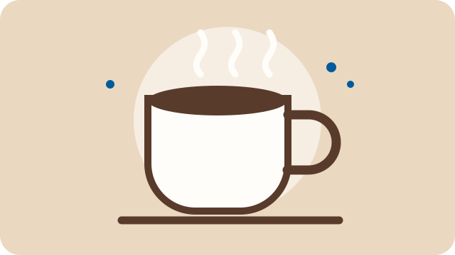

# Mein Kaffeeritual für eine gute Pause

Eine kleine Pause kann einen langen Tag gleich viel angenehmer machen. Mein Kaffeeritual ist einfach: Ich suche mir eine Lieblingstasse aus, bereite frischen Kaffee zu und nehme mir ein paar Minuten Zeit. Am liebsten trinke ich einen **Cappuccino** am Morgen oder einen *Filterkaffee* am Nachmittag. Der Duft von frisch gebrühtem Kaffee macht die Küche gemütlich, und die kurze Pause hilft mir, danach wieder konzentriert weiterzuarbeiten.

## So bereite ich meine Pause vor

1. Ich wähle meine Lieblingstasse aus.
2. Ich mahle die Bohnen frisch und brühe den Kaffee auf.
3. Ich mache es mir bequem und genieße meine Pause.

Für einen Cappuccino schäume ich etwas Milch auf und gebe sie vorsichtig zum Espresso. Dazu passt ein Keks oder ein Stück Obst. Wenn es draußen warm ist, lasse ich den Kaffee abkühlen und serviere ihn mit Eiswürfeln. So wird aus dem warmen Getränk ein erfrischender Eiskaffee.

## Was zu meiner Pause dazugehört

- eine saubere Lieblingstasse
- frisch gemahlene Kaffeebohnen
- ein ruhiger Platz ohne Ablenkung
- ein kleiner Snack für den Genuss

Mehr Ideen für die Zubereitung gibt es bei [Kaffeezentrale](https://www.kaffeezentrale.de/).

Mein kleiner Merksatz für die Zubereitung lautet: `frisch mahlen, langsam aufbrühen, in Ruhe genießen`.

> Eine gute Pause muss nicht lang sein – wichtig ist, dass man sie bewusst genießt.
